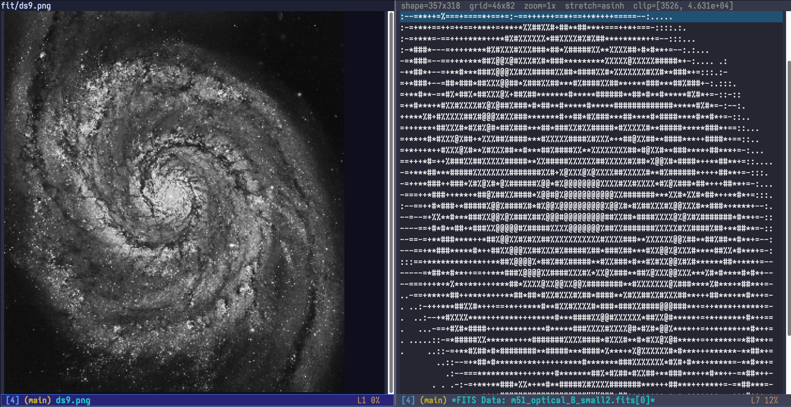

# fits-mode

An Emacs major mode for browsing [FITS](https://fits.gsfc.nasa.gov/) files — without loading the binary payload into a buffer.

`fits-mode` provides a set of read-only views for inspecting FITS HDUs, headers, table columns and table data, and shows images as zoomable ASCII-art pictures, all from within Emacs. It uses a small Python/[astropy](https://www.astropy.org/) helper script as the parsing back-end and communicates over JSON, so the Emacs side stays pure Elisp with no binary I/O.

---

## Requirements

| Dependency | Notes |
|---|---|
| Emacs | 29.1 or later recommended (uses `header-line-indent-mode`) |
| Python 3 | `python3` on `PATH`, or set `fits-mode-python-executable` |
| astropy | `pip install astropy` |

---

## Installation

1. **Clone or copy** both `fits-mode.el` and `fits-helper.py` into the same directory on your `load-path`, for example `~/.emacs.d/lisp/fits-mode/`.

2. **Install the Python dependency:**

   ```sh
   pip install astropy
   ```

3. **Load the package** in your Emacs configuration:

   ```elisp
   ;; Minimal
   (add-to-list 'load-path "~/.emacs.d/lisp/fits-mode")
   (require 'fits-mode)
   ```

   Or with `use-package`:

   ```elisp
   (use-package fits-mode
     :load-path "~/.emacs.d/lisp/fits-mode")
   ```

4. **That's it.** Opening any `.fits`, `.fit`, `.fits.gz`, or `.fits.fz` file with `find-file` will launch `fits-mode` automatically. The raw binary payload is never loaded into the buffer — only the rendered view.

---

## Opening a FITS file

```
M-x find-file RET my-data.fits RET
```

or

```
M-x fits-open-file RET my-data.fits RET
```

Either command opens the **HDU list** view.

### Try it with the example image

The repository includes an example file, `m51_optical_B_small.fits`: a 357 × 318 pixel optical (B-band) image of the spiral of the Whirlpool Galaxy, M51. Open it, move to the `PRIMARY` row and press `d` to see it drawn as ASCII art (see [Image HDUs](#image-hdus) below).

> **Image credit:** the example image (`m51_optical_B_small.fits`, `m51_optical_B_small.png`, and the image shown in `fits-mode-screenshot.png`) is credited to **NASA/STScI**. It comes from the Chandra X-ray Center's Open FITS multiwavelength data page: <https://chandra.harvard.edu/photo/openFITS/multiwavelength_data.html>

---

## Views

### HDU list (`fits-hdu-list-mode`)

The entry point. Shows one row per Header/Data Unit with its index, name, type, dimensions, and a short summary.

```
  FITS: /data/observation.fits

  #  Name          Type       Dims              Info
  ─────────────────────────────────────────────────────────────────
  0  PRIMARY       IMAGE      [2048 × 2048]     BITPIX=-32
  1  SCI           IMAGE      [2048 × 2048]     EXTVER=1
  2  EVENTS        BIN_TABLE  1024 rows × 8 cols TFIELDS=8
  3  GTI           BIN_TABLE  12 rows × 2 cols  TFIELDS=2
```

**Key bindings:**

| Key | Action |
|-----|--------|
| `RET` | Open header / columns / data (prompts if multiple apply) |
| `h` | Open header view for current HDU |
| `c` | Open columns view (table HDUs only) |
| `d` | Open data view |
| `g` | Refresh HDU list |
| `q` | Quit window |

---

### Header view (`fits-header-mode`)

Shows all FITS header cards for the selected HDU as a two-column table (keyword / value). Long string values are not truncated.

```
  Header: EVENTS (HDU 2)  —  /data/observation.fits

  Keyword        Value
  ─────────────────────────────────────────────────
  XTENSION       BINTABLE
  BITPIX         8
  NAXIS          2
  NAXIS1         64
  NAXIS2         1024
  TFIELDS        8
  TTYPE1         TIME
  TFORM1         D
  TTYPE2         RA
  TFORM2         E
  …
```

**Key bindings:**

| Key | Action |
|-----|--------|
| `q` | Back to HDU list |
| `g` | Refresh |

---

### Columns view (`fits-columns-mode`)

Available for table HDUs. Shows each column's index, TTYPE (name), TFORM (FITS format code), TUNIT (unit), and a short description where present.

```
  Columns: EVENTS (HDU 2)  —  /data/observation.fits

  #   Name     Format   Unit       Description
  ─────────────────────────────────────────────────
  1   TIME     D        s
  2   RA       E        deg
  3   DEC      E        deg
  4   ENERGY   E        keV
  5   GRADE    I
  6   DETX     I        pixel
  7   DETY     I        pixel
  8   STATUS   B
```

**Key bindings:**

| Key | Action |
|-----|--------|
| `q` | Back to HDU list |
| `g` | Refresh |

---

### Data view (`fits-data-mode`)

#### Table HDUs

Displays paginated table rows with dynamically-sized, right-aligned numeric columns. Numbers are rounded to `fits-mode-data-sig-figs` significant figures (default: 4). Column headers stay visible and scroll horizontally with the data.

```
  Data: EVENTS (HDU 2)  —  rows 1–200 of 1024  —  /data/observation.fits

  TIME        RA       DEC      ENERGY   GRADE   DETX   DETY   STATUS
  ───────────────────────────────────────────────────────────────────
  1.234e+08   83.82    -5.391   2.341       0    512    511       0
  1.234e+08   83.75    -5.402   0.9127      1    498    523       0
  1.234e+08   83.91    -5.378   7.654       0    530    504       0
  …
```

#### Image HDUs

By default, image HDUs are shown as an ASCII-art picture. The first 2-D plane of the image is:

1. block-averaged down to the width of the window, keeping the aspect ratio (scroll down for tall images; NaN pixels are skipped),
2. clipped at the 0.5 and 99.5 percentiles,
3. stretched (`asinh` by default), and
4. drawn with a character ramp from dark (a space) to bright (`@`).

As in DS9, pixel (1,1) is at the bottom left. The header line shows the image's shape and the size of the picture (both as rows × columns), the zoom, stretch and clip levels. The line above the picture is a reminder of the keys.

This screenshot shows the example M51 image: on the left, a DS9 rendering of it (as a PNG, viewed in Emacs); on the right, `fits-mode`'s ASCII view of `m51_optical_B_small.fits` at the default zoom.



*Example image credit: NASA/STScI, via [Chandra Open FITS](https://chandra.harvard.edu/photo/openFITS/multiwavelength_data.html).*

**Changing the stretch.** Press `s` to cycle through `linear` → `sqrt` → `log` → `asinh`. `linear` shows only the brightest parts; `log` and `asinh` bring out faint structure such as spiral arms.

**Zooming.** Press `+` (or `=`) to zoom in and `-` to zoom out, by a factor of 1.5 each time (`fits-mode-image-zoom-step`); `0` resets. Zooming in draws the picture with more characters, so finer detail appears, up to one character per pixel, after which `+` tells you the image is at full resolution. Use the normal motion keys to scroll, and `C-x <` / `C-x >` to scroll sideways.

**Numbers.** Press `t` to switch to a downsampled grid of pixel values, with summary statistics (min, max, mean, standard deviation) in the mode line; press `t` again to return to the picture. Zoom also scales this grid.

**Look and size.** The characters, picture size, aspect correction, stretch and clipping are all configurable; see the `fits-mode-image-*` variables under [Configuration](#configuration). For a smoother picture in fonts that support it, set `fits-mode-image-ascii-ramp` to `" ░▒▓█"`.

**Key bindings:**

| Key | Action |
|-----|--------|
| `n` | Next page of rows (table HDUs) |
| `p` | Previous page of rows (table HDUs) |
| `j` | Jump to row offset (table HDUs) |
| `t` | Toggle ASCII picture / numeric grid (image HDUs) |
| `s` | Cycle ASCII stretch: linear, sqrt, log, asinh (image HDUs) |
| `+` / `=` | Zoom image preview in (image HDUs) |
| `-` | Zoom image preview out (image HDUs) |
| `0` | Reset zoom (image HDUs) |
| `q` | Back to HDU list |
| `g` | Refresh / reload current page |

---

## Configuration

All variables belong to the `fits-mode` customization group (`M-x customize-group RET fits-mode`).

| Variable | Default | Description |
|---|---|---|
| `fits-mode-python-executable` | `"python3"` | Python interpreter used to run the helper. Set this to a full path or virtualenv python if needed. |
| `fits-mode-data-page-size` | `200` | Number of table rows loaded per page. |
| `fits-mode-data-sig-figs` | `4` | Significant figures for floating-point cells in data views. Header card values are always shown at full precision. |
| `fits-mode-data-max-column-width` | `40` | Maximum character width of a data column. Columns are otherwise sized to fit their content on the current page. |
| `fits-mode-image-grid-size` | `(40 . 24)` | Dimensions `(rows . columns)` of the numeric preview grid for image HDUs at zoom 1. |
| `fits-mode-image-default-view` | `ascii` | Initial view for image HDUs: `ascii` (picture) or `table` (numeric grid). |
| `fits-mode-image-ascii-ramp` | `" .:-=+*#%@"` | Characters from darkest to brightest. Try `" ░▒▓█"` for a smoother look. |
| `fits-mode-image-ascii-nan-char` | `?\s` | Character used where a cell holds only NaN pixels. |
| `fits-mode-image-ascii-max-size` | `nil` | Size `(columns . rows)` of the ASCII picture at zoom 1; `nil` sizes it to the window. |
| `fits-mode-image-ascii-fit` | `width` | With no fixed size: `width` fills the window width (scroll for tall images); `window` fits the whole image in the window. |
| `fits-mode-image-zoom-step` | `1.5` | Factor each `+`/`-` press zooms by. |
| `fits-mode-image-char-aspect` | `2.0` | Height/width ratio of a character cell, used to keep the aspect ratio correct. |
| `fits-mode-image-stretch` | `asinh` | Initial stretch: `linear`, `sqrt`, `log` or `asinh`. |
| `fits-mode-image-clip-percentiles` | `(0.5 . 99.5)` | Low/high percentiles at which pixel values are clipped for display. |
| `fits-mode-file-regexp` | `\\.\\(fits\|fit\\)\\(\\.\\(fz\|gz\\)\\)?\\'` | Regexp controlling which file names trigger auto-mode and the file handler. |
| `fits-mode-columns-name-width` | `24` | Maximum display width for column names in `fits-columns-mode`. Increase this if your FITS table column names are longer than the default. |

Example customization:

```elisp
(use-package fits-mode
  :load-path "~/.emacs.d/lisp/fits-mode"
  :custom
  (fits-mode-python-executable "/home/user/.venvs/astro/bin/python")
  (fits-mode-data-page-size 500)
  (fits-mode-data-sig-figs 6)
  (fits-mode-image-grid-size '(60 . 30))
  (fits-mode-image-stretch 'log)
  (fits-mode-image-zoom-step 2.0)
  (fits-mode-image-ascii-ramp " ░▒▓█")
  (fits-mode-columns-name-width 32))
```

---

## How it works

`fits-mode` is split into two parts:

- **`fits-mode.el`** — the Emacs Lisp front-end. It registers a `file-name-handler-alist` entry (the same mechanism used by `jka-compr` for transparent decompression) so that `find-file` on a FITS file intercepts `insert-file-contents`, prevents the binary payload from ever entering the buffer, and routes the buffer to `fits-hdu-list-mode`. All interactive views are built on `tabulated-list-mode`.

- **`fits-helper.py`** — a small Python script that accepts a subcommand (`info`, `header`, `columns`, `data`, `ascii`) plus file path and parameters on the command line, and emits a JSON response. `fits-mode.el` calls this script synchronously via `call-process` and parses the result.

Both files must live in the **same directory**; the Elisp locates the helper script relative to its own file path at load time.

---

## Troubleshooting

**`fits-mode: Python helper failed` or `ModuleNotFoundError: astropy`**
Astropy is not installed for the Python executable `fits-mode` is using. Run:
```sh
pip install astropy
```
or set `fits-mode-python-executable` to point to a Python that has astropy:
```elisp
(setq fits-mode-python-executable "/path/to/venv/bin/python")
```

**File opens as raw binary / garbled text**
The `file-name-handler-alist` entry may not be active. Check that the file name matches `fits-mode-file-regexp` and that `(require 'fits-mode)` ran without error.

**New keys don't work after updating**
If you load a new version of `fits-mode.el` into an Emacs session that already had an older one loaded, existing FITS buffers keep their old state. Kill the `*FITS …*` buffers and open the file again; restarting Emacs is the surest fix. Check which file Emacs actually loads with `M-x locate-library RET fits-mode`; if it is an old `fits-mode.elc`, delete or recompile it, because Emacs prefers the `.elc` even when the `.el` is newer.

**Image preview is mostly blank or all one character**
Try `s` to change the stretch: astronomical images often have a few very bright pixels, so a `linear` stretch leaves everything else dark. Large blank areas usually mean NaN pixels; set `fits-mode-image-ascii-nan-char` to a visible character such as `?·` to show them.

**Line wrapping in data view**
`fits-data-mode` sets `truncate-lines`, `word-wrap`, and `visual-line-mode` buffer-locally and guards against global hooks re-enabling wrapping. If wrapping persists, check for a global mode that forces `visual-line-mode` on unknown buffer types.

**Column header misaligned with data**
The header line is rendered with an `:eval` form that reads `window-hscroll` on every redisplay. If it still looks off, try `g` to refresh the buffer, which rebuilds the column format from the current page's content.

---

## Credits

The example image `m51_optical_B_small.fits` (and its PNG version, `m51_optical_B_small.png`, also shown in `fits-mode-screenshot.png`) is credited to **NASA/STScI**, and was obtained from the Chandra X-ray Center's Open FITS multiwavelength data page: <https://chandra.harvard.edu/photo/openFITS/multiwavelength_data.html>
